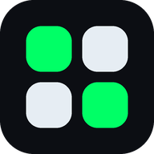

# Deck

**A Stream Deck for your Windows screen.** A 15-button control pad that lives on your desktop: launch apps and sites, fire hotkeys, paste email templates and AI prompts, start focus timers, control Home Assistant. One small exe, no installer, no account, nothing leaves your PC.

**[Download Deck.zip](assets/Deck.zip)** · [Landing page](https://johnlaz.github.io/deck/)

## Why Deck

- **Launch anything:** apps, files, folders and sites, with app-or-web fallbacks.
- **Hotkeys:** show desktop, snip, media and volume keys, mic mute, lock PC.
- **Templates:** paste ready-made emails and prompts, formatting intact.
- **Context pages:** Outlook and Spotify pages appear automatically when those apps are in front.
- **Focus timer:** one-button 25-minute blocks.
- **Home Assistant:** optional light, scene and lock buttons with confirmations.
- **Export / Import:** save your whole setup (layout, icons, templates) to one file and load it on any PC.

## Install

1. Download `Deck.zip` and extract `deck.exe` anywhere.
2. Double-click it. A tray icon appears and the deck opens in its own window.
3. Optional: tray menu → **Start with Windows**.

Windows may warn about an unsigned app: **More info → Run anyway**.

Settings live in `%APPDATA%\LazDeck`. Windows 10/11, 64-bit.

---
Deck · © 2026 LAZLAB Creations
